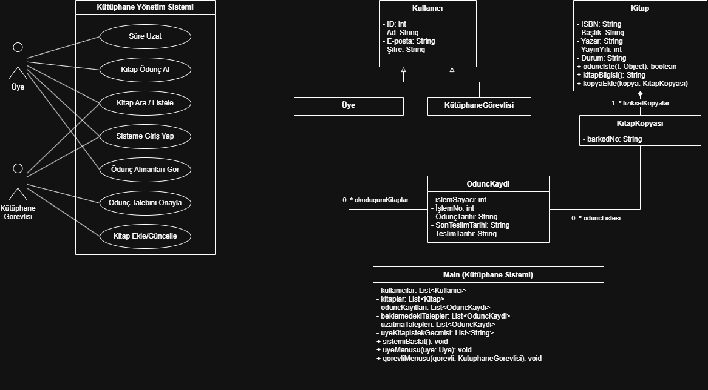

# Online Kütüphane Yönetim Sistemi (OKYS)

Bu proje, **YBS203 Nesne Yönelimli Programlama** dersi kapsamında geliştirilmiş, konsol (terminal) tabanlı interaktif bir kütüphane otomasyon sistemidir. Sistem, üyelerin kitap arama ve ödünç alma süreçlerini dijitalleştirirken, kütüphane görevlilerinin de bu süreçleri (onaylama, kitap/kopya ekleme, süre uzatma, iade alma vb.) pratik bir şekilde yönetmesine olanak tanır.

## 🗂️ Proje Yapısı

- **`src/`** : Uygulamanın çalışmasını sağlayan, Java ile yazılmış Nesne Yönelimli (OOP) kaynak kodları burada yer alır:
  - `Kitap.java` : Kitap künyesi metaverileri ve fiziksel kopya koleksiyonu.
  - `KitapKopyasi.java` : Raftaki somut nüsha, barkod ve anlık durum yönetimi.
  - `KitapDurumu.java` : Kopyanın durumunu tutan tip güvenli Enum (`MEVCUT`, `ODUNCTE`).
  - `Kullanici.java` : Temel kullanıcı bilgilerini tutan ata (süper) sınıf.
  - `Uye.java` : Kullanıcıdan türetilen, ödünç alma geçmişine sahip üye sınıfı.
  - `KutuphaneGorevlisi.java` : Sistem yöneticisi yetkilerine sahip görevli sınıfı.
  - `OduncAlma.java` : Üye ile KitapKopyasi arasındaki ödünç alma işlem köprüsü (Association Class).
  - `Main.java` : Rol bazlı dinamik konsol arayüzü ve test verileri.
- **`doc/`** : 
  - `okys-SRS.doc` : Sistemin yazılım gereksinim analizi ve işleyiş senaryosu.
  - `okys-DESIGN.drawio` : Sistemin detaylı Sınıf (Class) ve Kullanım Senaryosu (Use Case) UML diyagramları.
  - `okys-DESIGN.png` : UML diyagramının görsel (resim) hali.
  - `OKYS_Proje_Raporu.md` : Projenin temel rapor dosyası.

<p align="center">
  
</p>

## 🚀 Mimari ve OOP Prensipleri (Uygulama #3 Standartları)

1. **Gelişmiş Kapsülleme (Encapsulation) & Doğrulama (Validation):**
   - Tüm sınıf değişkenleri `private` olarak tanımlanmıştır.
   - Constructor ve metotlarda geçersiz/boş değerler (`null` veya boş metin) engellenerek veri bütünlüğü güvence altına alınmıştır.
2. **Değişmezlik (Immutability):**
   - Kimlik belirten ve değişmemesi gereken alanlar (`isbn`, `barkod`, `id`, `islemNo`) `final` olarak tanımlanmış, bunlara setter yazılmamıştır.
3. **Çift Yönlü İlişki (Bidirectional Association):**
   - `Kitap` ve `KitapKopyasi` sınıfları arasında Slayt 5'te belirtilen model uygulanmıştır. Bir `KitapKopyasi` oluşturulduğu anda constructor'ı aracılığıyla ait olduğu `Kitap` nesnesinin koleksiyonuna kendisini otomatik olarak kaydeder (`kitap.kitapKopyasiEkle(this)`).
4. **Durum Ayrımı:**
   - Kitap soyut bir katalog kaydı olduğu için durum bilgisi kitaptan kaldırılarak raftaki fiziksel nüshayı temsil eden `KitapKopyasi` sınıfına `KitapDurumu` enum tipiyle taşınmıştır.

## 🛠️ Nasıl Çalıştırılır?

Projeyi bilgisayarınızda çalıştırmak için **Java (JDK 8 veya üzeri)** kurulu olmalıdır. Terminal veya Komut İstemi'ni (CMD) kullanarak aşağıdaki adımları izleyebilirsiniz:

1. Projenin bulunduğu dizinde terminali açın.
2. `src` klasörünün içine girin:
   ```bash
   cd src
   ```
3. Mevcut tüm Java sınıflarını derleyin:
   ```bash
   javac *.java
   ```
4. Programın ana sınıfını (Main) çalıştırın:
   ```bash
   java Main
   ```

### 🔑 Test İçin Hazır Giriş Bilgileri (Demo Hesaplar)

Sistemi çalıştırdığınızda hemen test edebilmeniz için içerisine varsayılan hesaplar eklenmiştir:

**👤 Üye Hesabı (Ödünç Alma & Arama İşlemleri):**
- **E-posta:** `ahmet@29mayis.edu.tr`
- **Şifre:** `1234`

**🛡️ Kütüphane Görevlisi Hesabı (Onaylama & Kitap Yönetimi):**
- **E-posta:** `admin@29mayis.edu.tr`
- **Şifre:** `admin`
